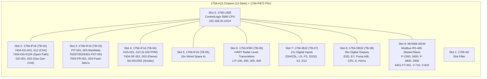

# GNTF Quinguila Tank Farm — ControlLogix 5580 (`1756-L82E`) ST Migration & Physical Twin Simulator

[-blue)](#controllogix-1756-a13-hardware-architecture)
[-00d4ff)](#structured-text-routine-architecture)
[-f59e0b)](#repository-deliverables)

Complete PLC migration, documentation suite, and real-time **Physical Twin + ControlLogix 5580 Soft-PLC Web Simulator** for the **Quinguila Tank Farm (`GNTF`) Control System Upgrade** (`FGCP-7404-001` / `P20890_Angola`).

This project decodes the legacy **GE Fanuc Proficy Machine Edition 7.00 (`VersaMax`)** ladder logic program, translates and upgrades it to **Allen-Bradley Studio 5000 Logix Designer Structured Text (ST)** for the `1756-L82E` ControlLogix 5580 controller, and provides a standalone, zero-dependency **Physical Twin Web Application** for Factory Acceptance Testing (FAT), Site Acceptance Testing (SAT), and operator training.

---

## Repository Deliverables

| File / Directory | Description |
| :--- | :--- |
| **[`GNTF_Physical_Twin_Simulator.html`](./GNTF_Physical_Twin_Simulator.html)** / **[`index.html`](./index.html)** | **Interactive Physical Twin & ControlLogix 5580 Soft-PLC Web App** (7 SCADA/Twin views, 2D Gaussian gas/fire plume dispersion, ODE fluid/tank/manifold physics, FGCP hardware mimic, live Cause & Effect verifier, Studio 5000 online ST debugger, and 9 automated FAT/SAT scenarios). |
| **[`P20890_Angola_AB_ST.L5X`](./P20890_Angola_AB_ST.L5X)** | **Studio 5000 Logix Designer Importable Project (`.L5X`)** for `1756-L82E` (v32) in a 13-slot `1756-A13` chassis with `1756-IF16`, `1756-IF8H`, `1756-IB32`, `1756-OB32`, and `MVI56E-MCM` modules, **683 Controller Tags**, and **25 ST routines**. |
| **[`P20890_Angola_AB_Complete.st`](./P20890_Angola_AB_Complete.st)** | Combined Allen-Bradley Structured Text source code for all 25 routines. |
| **[`ab_st_routines/`](./ab_st_routines/)** | Individual `.st` files for all 25 Structured Text routines (`MainRoutine.st` through `Output.st`). |
| **[`P20890_Angola_AB_Tags.csv`](./P20890_Angola_AB_Tags.csv)** | Studio 5000 Tag Database CSV export containing all 683 controller tags, hardware aliases, timer/counter structures, and engineering descriptions. |
| **[`P20890_Angola_AB_ST.pdf`](./P20890_Angola_AB_ST.pdf)** | **46-Page Printable A4-Landscape Engineering Report** containing the `1756-A13` rack architecture, complete I/O & terminal block cross-reference (`TB-02`..`TB-08`), setpoints, and formatted ST code. |
| **[`P20890_Angola_AB_ST.html`](./P20890_Angola_AB_ST.html)** | Interactive dark-mode Structured Text code viewer & I/O cross-reference browser with one-click copy. |
| **[`P20890_Angola_Ladder.pdf`](./P20890_Angola_Ladder.pdf)** | **34-Page Printable A4-Landscape Ladder Diagram Export** decoded directly from the legacy GE Proficy Machine Edition `.SwxCF` binaries (226 rungs across 24 blocks). |
| **[`P20890_Angola_Ladder.html`](./P20890_Angola_Ladder.html)** | Interactive vector SVG Ladder Diagram viewer for the legacy GE VersaMax program. |
| **[`build_physical_twin.py`](./build_physical_twin.py)** | Python build script that compiles the Physical Twin & Soft-PLC Web Simulator (`GNTF_Physical_Twin_Simulator.html`). |
| **[`generate_ab_st.py`](./generate_ab_st.py)** | Python generator for the Studio 5000 `.L5X`, `.st` routines, `.csv` tag database, `.pdf`, and `.html` reports. |
| **[`pme_parse.py`](./pme_parse.py)** / **[`export_ladder.py`](./export_ladder.py)** / **[`export_pdf.py`](./export_pdf.py)** | Binary decoders and vector PDF/HTML exporters for GE Proficy Machine Edition `.SwxCF` archives without requiring PME installation or administrator privileges. |

---

## ControlLogix `1756-A13` Hardware Architecture

Per engineering documents **`01-MAN-03-11-PDF-C3A`** (System Architecture), **`01-MAN-03-06-PDF-C2C Final`** (I/O List), and **`01-MAN-02-13-PDF-C1A`** (Terminal Block Connection Diagrams):

| Slot | Module | Terminal Block | Assigned Instruments & Signals |
| :--- | :--- | :--- | :--- |
| **Slot 0** | `1756-L82E` | Ethernet | ControlLogix 5580 Controller (`192.168.20.10`) |
| **Slot 1** | `1756-N2` | — | Empty Slot Filler |
| **Slot 2** | `1756-IF16` | `TB-02` | `Ch0..11`: **CH4 Point Gas Detectors** `7404-DG-001..012` (0–100 %LEL, Low=20%, High=30%) `Ch12`: **Open-Path IR Detector** `7404-DG-011R` (0–5.00 LELm, Low=1.00, High=3.00, Optic Fault `-0.78125`..`-0.46875` LELm) `Ch13..15`: **Gas Generator Room CH4 Detectors** `GD-001..003` (0–100 %LEL, Low=20%, High=30% -> `SD-GE`) |
| **Slot 3** | `1756-IF16` | `TB-03` | `Ch0`: `PIT-001` Oil Expedition (0–200 Psi, PAL=10, PAH=100) `Ch1`: `PIT-002` Water Injection Manifold (0–1500 Psi, PAL=200, PAH=800, PAHH=900 -> trips `P-3800/3900` & `P-3600/3700`) `Ch2`: `PIT-003` Power Oil Manifold (0–3000 Psi, PAL=1700, PAH=2700, PAHH=2800 -> trips `P-2300..2600` & `P-2100/2200`) `Ch3`: `7503-PST-001` Deluge Line Pressure (0–100 Psi, PAH=50 -> Foam Released) `Ch4`: `7002-PST-001` Air Accumulator ESDV (0–100 Psi, PAL=50 -> `L16`) `Ch5`: `6401-PST-001` Fuel Gas Line (0–150 Psi, PAL=40 -> `L17`, PAH=100 -> Station ESD) `Ch6..7`: Manual Foam Release Call Points `7503-FR-003` (Inside PCR) & `7503-FR-001/002` (Outside Bund) |
| **Slot 4** | `1756-IF16` | `TB-04` | `Ch0..11`: **H2S Gas Detectors** `H2S-001..012` (0–100 PPM, Low=10 PPM Discontinuous `H2SA-001/002`, High=20 PPM Continuous) `Ch12..14`: **Flame Detectors** `7404-DF-001..003` (0–100%, Alarm=30%) `Ch15`: **Smoke Detectors** `SD-001/002` (0–100%, Alarm=30% -> `SD-GE` & `SDA-001`) |
| **Slot 5** | `1756-IF16` | `TB-05` | `Ch0..15`: 16x Wired Spare 4–20 mA Analog Inputs |
| **Slot 6** | `1756-IF8H` | `TB-06` | `Ch0..2`: **Tank Radar Level Transmitters** `LIT-100`, `LIT-200`, `LIT-300` (0–10.0 m, LAL=0.7 m, LAH=9.0 m) `Ch3`: **Tank Radar Level Transmitter** `LIT-400` (0–12.0 m, LAL=0.7 m, LAH=11.0 m) |
| **Slot 7** | `1756-IB32` | `TB-07` | `Pt0..20`: `6401-ZSH-001` (Open), `6401-ZSL-001` (Closed), `FS_FGCP_E8` (Panel Foam Stop), `7503-LS-002` (Diesel Low), `7503-FS-001` (Field Foam Stop), `7503-LS-001` (Foam Low), `75-C-01A/B` (Pump A/B Line Check), `75-SB-01B` (Pump B Inhibit), `Reset_PB_E11`, `Mute_PB_E12`, `6401-ESDV-001` (`E9`), `INHIBIT_FOAM_REL` (`S2`), `INHIBIT_ALL_OUTPUTS` (`S3`), `7404-SB-004..009` (`E1..E6` Pump E-Stops) |
| **Slot 8** | `1756-OB32` | `TB-08` | `Pt0..31`: `PumpShutdown` (`ESD_TRIP`), `6401-EY-001/002`, `7404-SA-001/002`, `Pump_A_PulsOut`, `PUMP_A`, `Pump_B_Start_PulsOut`, `PUMP_B_START`, `PUMP_B_STOP`, `P2100_P2200`, `P3600_P3700`, `PLC_Fault`, `L14..L17` LEDs, `CR1..CR6` Pump Trip Relays (`L8..L13`), `SD_GE`, `Z1` PCR Horn, `PA_001`, `H2SA_001_002`, `SDA_001` |
| **Slot 9** | `MVI56E-MCM` | RS-485 | Modbus Master/Slave to Power Oil Pumps (`P-2300..2500` TTD-H, `P-2600` S1501), Water Injection Pumps (`P-3800..3900` TTD-H), Expedition Flowmeter `6401-FT-001` (0–500 bbl/h, FAL=30, FAH=300), and Heater Treaters (`V-710`, `V-810`) |

---

## Structured Text Routine Architecture

All 25 Structured Text routines inside `MainProgram` (in [`ab_st_routines/`](./ab_st_routines/)):

1. **`MainRoutine.st`**: Executive scheduler, first-scan initialization, 400 ms flasher oscillator (`R01598_0`), and `JSR` calls.
2. **`Init.st`**: Calibration zero/span ranges and alarm thresholds per `01-MAN-03-13-PDF-C1`.
3. **`Input.st`**: Hardware input mapping from `Local:2:I`..`Local:9:I` to internal tag registers.
4. **`DI_1.st`**: ESDV limit switch discrepancy timers (`10.0s`), Foam Stop pushbuttons, and Foam/Diesel tank low-level switches.
5. **`DI_2.st`**: 60-second pulsed open-circuit continuity monitoring for Deluge Pumps A & B, Keyswitches `S2`/`S3`, `E9` ESD button, and `E1..E6` Pump E-Stops.
6. **`AI_1.st` & `CalcVa1.st`**: Linear engineering unit scaling (`0–32000` raw counts) and wire-break/overrange fault detection for `7404-DG-001..008`.
7. **`AI_2.st` & `CalcVa2.st`**: Scaling and fault detection for `7404-DG-009..012`, `7404-DF-001..002`, and Open-Path `7404-DG-011R` (including `-0.78125` to `-0.46875 LELm` optical beam block window).
8. **`AI_3.st` & `CalcVa3.st`**: Scaling and fault detection for `7002-PST-001`, `6401-PST-001`, `7503-PST-001`, and Foam Call Points `7503-FR-001..003`.
9. **`AI_4_New.st`**: GNTF Upgrade scaling and alarm latches for `GD-001..003`, `PIT-001..003` (`PAL`/`PAH`/`PAHH`), `H2S-001..012`, `7404-DF-003`, `SD-001/002`, `LIT-100..400`, and `6401-FT-001`.
10. **`Ai_AL_1.st`, `Ai_AL_2.st`, `Ai_AL_3.st`**: Latched Low/High alarm evaluation with `M00002_System_Reset` release.
11. **`Vote_1.st`**: `1ooN` and `2ooN` voting across CH4 gas detectors (`R01500_0..3`) and flame detectors (`R01501_0..1`).
12. **`Logic.st`**: Firewater/Foam Deluge duty `PUMP_A` control, 10-second pressure proving timer (`TMR_PumpA_FailToRun` for `7503-PST-001 >= 50 Psi`), and automatic 3-attempt crank start sequence for standby diesel `PUMP_B`.
13. **`CE_LOG.st`, `Indicat.st`, `Shutdow.st`, `Protect.st`, `Loc_Al.st`, `FLT_1.st`, `Sound.st`, `Output.st`**: Complete Cause & Effect Matrix (`01-MAN-03-07-PDF-C2C Final`) driving fail-safe ESD outputs, individual pump trip relays `CR1..CR6`, `SD-GE`, discontinuous (1 Hz) vs. continuous horns/beacons, and `Local:8:O.Data.0..31`.

---

## Physical Twin & Soft-PLC Web Simulator

Open **[`GNTF_Physical_Twin_Simulator.html`](./GNTF_Physical_Twin_Simulator.html)** directly in any modern browser (Chrome, Edge, Firefox) — no server or installation needed:

- **Tab 1 — `P&ID PROCESS TWIN`**: Interactive animated P&ID of the Quinguila Tank Farm with coupled ODE fluid/pressure dynamics and equipment faceplates.
- **Tab 2 — `2D F&G PLUME MAP`**: Site layout with real-time 2D Gaussian plume advection (click map to inject CH4, H2S, Pool Fire, or Smoke with wind speed/direction sliders) + individual channel overrides and fault injection.
- **Tab 3 — `FGCP-7404-001 PANEL`**: Interactive hardware annunciator panel with `L8..L17` lamps, `S2`/`S3` keyswitches, `E1..E6`/`E9` E-Stops, `E8` Foam Stop, `E11` Reset, `E12` Mute, and optional Web Audio horn synthesizer.
- **Tab 4 — `LIVE C&E MATRIX`**: Real-time Cause & Effect intersection table with one-click test triggers for all 24 Cause rows.
- **Tab 5 — `1756 RACK & ST DEBUGGER`**: Live `1756-A13` slot/channel inspector (`4–20 mA` currents, raw counts, DI/DO states) and Studio 5000 Online ST Code Monitor.
- **Tab 6 — `FAT / SAT SCENARIOS`**: 9 automated Factory/Site Acceptance Test sequences (`FAT-01` through `FAT-09`).
- **Tab 7 — `TRENDS & HISTORIAN`**: High-speed 6-pen strip chart recorder and ISA-18.2 Sequence of Events (SOE) historian with CSV export.

---

## Importing into Studio 5000 Logix Designer

1. Launch **Studio 5000 Logix Designer** (v28 or v32+).
2. Click **File -> Open** and select **[`P20890_Angola_AB_ST.L5X`](./P20890_Angola_AB_ST.L5X)**.
3. Specify the target `.ACD` filename (`P20890_Angola_AB_ST.ACD`) and click **Import**.
4. Verify the 13-slot `1756-A13` I/O Configuration tree, Controller Tags (683 tags), and `MainProgram` (25 ST routines).
